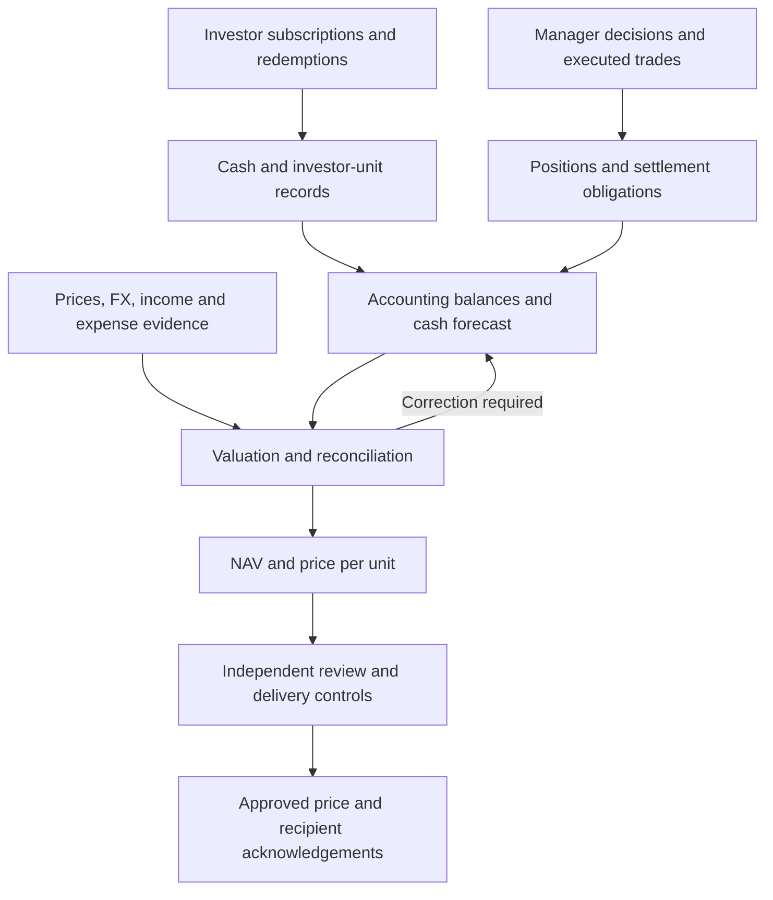

# Finance, Data & AI — Professional Knowledge and Contribution Guide

**Ankit Bhatt | Fund Administration transformation, data engineering and controlled automation**

Use this guide to explain the business model, reconstruct calculations and present your contribution. Installation and deployment are covered in the [project README](README.md).

**Evidence distinction:** contributions summarise the supplied experience. App funds, figures, actors and approvals are fictional. The app uses explicit rules, with no LLM calls, real trade submission or authenticated approval.

## Contents

1. [Professional positioning](#professional-positioning)
2. [The connected business model](#the-connected-business-model)
3. [Ten operational stages of the NAV lifecycle](#ten-operational-stages-of-the-nav-lifecycle)
4. [Twelve technical valuation steps](#twelve-technical-valuation-steps)
5. [Ten stages of the guided case](#ten-stages-of-the-guided-case)
6. [Essential formulas and interpretation](#essential-formulas-and-interpretation)
7. [Reconstruct the fictional case](#reconstruct-the-fictional-case)
8. [Professional contribution](#professional-contribution)
9. [Interview discussion points](#interview-discussion-points)
10. [Final preparation checklist](#final-preparation-checklist)

## Professional positioning

### A concise introduction

> I combine more than a decade in financial services with a Master's pathway in Data Engineering and Artificial Intelligence. During my Fund Administration transformation and Data Office internship, I translated operational requirements into structured data, reporting and controlled automation, supporting validation and stakeholder decisions. This portfolio connects that contribution with a fictional fund case.

### A concrete project explanation

> I follow a fictional fund from source intake through valuation, reconciliation, NAV and reviewed delivery. Results retain their source and downstream purpose. Distinguishing ledger cash from forecast cash, funds from events, and UAT from daily approval demonstrates how business meaning guides the data model and controls.

The value proposition is **business understanding → data discipline → explainable implementation → validation → accountable delivery**. Explain actions and evidence before tools.

## The connected business model

Investors subscribe cash for fund units. The manager invests the pooled assets. Execution establishes trade terms; settlement transfers cash and securities. Accounting recognises assets and obligations; valuation determines net assets and unit price. Reconciliation and review support distribution.

| Responsibility | Business purpose |
| --- | --- |
| Investment manager | Invests within the mandate; supplies trade information. |
| Fund administrator | Maintains accounting; prepares valuation. |
| Transfer agent | Maintains investor units and dealing. |
| Custodian / depositary | Safekeeping, independent records and oversight, depending on the arrangement. |
| Client Account Manager (CAM) | Coordinates communication; Operations owns financial evidence. |

**Distinguish:** NAV measures ownership value; forecast cash estimates payment capacity; reconciliation exposure measures an amount under investigation.

## Ten operational stages of the NAV lifecycle

The operational view explains **ownership, inputs and outputs**. It is an illustrative control chain, not a universal regulatory sequence; corrections require iteration.

| Stage | Main activity | Expected controlled output |
| --- | --- | --- |
| 01. Fund setup | Confirm rules, calendar, class and sources. | Fund reference and owners. |
| 02. Transactions | Validate trade/dealing capture and settlement. | Booked transactions. |
| 03. Pricing | Check prices, FX, timestamps and overrides. | Approved inputs. |
| 04. Reconciliation | Compare independent records. | Cleared or escalated differences. |
| 05. Pre-NAV checks | Assess readiness and blocking exceptions. | Proceed or investigate. |
| 06. Simulation | Calculate and challenge draft valuation. | Draft NAV. |
| 07. Accounting | Validate adjustments and balanced entries; rerun. | Accounting package. |
| 08. Control and sign-off | Review calculations, exceptions and checklist. | Reviewed package. |
| 09. Client submission | Check timing, queries and acknowledgement. | Submission status. |
| 10. Price distribution | Distribute approved version; monitor receipt. | Acknowledgements and evidence. |

Source: [NAV control room](institutional_streamlit_portfolio/app_pages/nav_production.py), `control_chain`.

## Twelve technical valuation steps

This view expands the **financial inputs, calculations and controls** within the operational lifecycle.

| Step | Technical focus | Key question |
| --- | --- | --- |
| 01 | Fund rules and valuation policy | Agreed dates, currency, dealing rules and sources? |
| 02 | Trade and position capture | Complete holdings, unsettled trades and reference data? |
| 03 | Cash and investor dealing | Reconciled cash, flows and units? |
| 04 | Corporate actions and income | Supported income, tax and entitlements? |
| 05 | Market valuation | Correct approved prices and FX conventions? |
| 06 | Liabilities and expense accruals | Complete fees, payables and obligations? |
| 07 | Three-way reconciliation | Independent records agree; differences assessed? |
| 08 | Net asset calculation | Correct assets, liabilities and units? |
| 09 | Anti-dilution assessment | Price adjustment required by dealing policy? |
| 10 | Reasonableness and tolerance review | Movements, stale inputs and liquidity challenged? |
| 11 | Maker-checker authorisation | Independent review of current evidence? |
| 12 | Controlled distribution and retention | Approved version delivered and retained? |

Source: [`NAV_FOUNDATION_STEPS`](institutional_streamlit_portfolio/data.py). The implemented swing trigger is **at least** the configured threshold; actual fund terms determine production rules.

## Ten stages of the guided case

The **educational execution sequence** adds business framing, lineage and reporting around valuation, ending in simulated delivery.

| Stage | Evidence produced | Connection to the next decision |
| --- | --- | --- |
| 01. Scope | Fund, class, date and acceptance criteria. | Establishes common context. |
| 02. Source intake | Preserved rows, identifiers and fingerprints. | Establishes population and lineage. |
| 03. Validation and modelling | Checked keys, dates and policies. | Protects joins and calculations. |
| 04. Position valuation | EUR holding values and roll-up. | Reconstructs investments. |
| 05. Accounting and cash | Balances, forecast, reserve and headroom. | Separates NAV inputs from liquidity. |
| 06. Reconciliation | Verified authority and resolution. | Updates event population. |
| 07. NAV | Net assets, units, price and swing assessment. | Supplies valuation and exposure denominators. |
| 08. Reporting | Matching, exposure and residual follow-up. | Supports materiality decisions. |
| 09. Quality and review | Gates, UAT and simulated independent review. | Determines delivery readiness. |
| 10. Delivery and monitoring | Simulated submission and acknowledgements. | Confirms acceptance and follow-up. |

Source: [`STEPS` and stage execution](institutional_streamlit_portfolio/app_pages/guided_pipeline.py).

## Essential formulas and interpretation

| Measure | Formula | Interpretation / control |
| --- | --- | --- |
| Position value in EUR | Quantity × local price × EUR per local-currency unit | Check FX direction. Simplified baskets; not a full bond/derivatives engine. |
| Total assets | Investments + ledger cash + receivables | Receivables are assets, not confirmed cash receipts. |
| Total liabilities | Payables + accrued expenses | An expense accrual reduces NAV before its cash payment. |
| NAV | Total assets − total liabilities | Aggregate net ownership value. |
| NAV per unit | NAV ÷ validated units | Consistent class and valuation point. |
| Net investor flow | Subscriptions − redemptions | Dealing activity is not investment performance. |
| Flow percentage | Absolute net flow ÷ NAV × 100 | Compare with the illustrative swing threshold. |
| Swing-adjusted price | Base price × (1 ± factor bps ÷ 10,000) | Eligible inflow: upward; outflow: downward. Otherwise unchanged. |
| Projected cash | Opening cash + subscriptions − redemptions − purchases + sales − collateral | Expected settlement cash; not current NAV cash. |
| Required cash buffer | Opening ledger cash × reserve percentage ÷ 100 | Illustrative reserve, not a payment. |
| Buffer headroom | Projected cash − required buffer | Aggregate test; not every intraday/currency obligation. |
| Exposure in bps | Open amount ÷ NAV × 10,000 | Relative scale of investigation; not automatically a valuation loss. |
| Match rate | Matched events ÷ all selected events × 100 | Count events, not funds. |
| Automatic share of matched | Automatic matches ÷ matched events × 100 | Its denominator differs from overall match rate. |
| Daily management-fee accrual | Fee base × annual bps ÷ 10,000 ÷ days in year | Supports 360/365/366; use actual fee terms. |
| Simplified performance fee | max(0, current unit price − HWM × (1 + hurdle % / 100)) × eligible units × fee % / 100 | HWM = high-water mark. Isolated calculator; no NAV expense booking. |
| Anomaly score | 0.3 × elapsed-time exception + 0.7 × calculation conflict | Invalid inputs: quarantine. Rule priority, not probability. |

**Basis points:** 1 bp = 0.01 percentage point; 100 bps = 1%; 50 bps = 0.50%. Annual fee on constant EUR 100 million: `100,000,000 × 50 / 10,000 = EUR 500,000`; daily accrual over 365 days: **EUR 1,369.86**. A changing base changes the total.

**Performance fee:** price EUR 112; HWM EUR 105; hurdle 2%; rate 20%; 100,000 eligible units. Reference = EUR 107.10; eligible gain = EUR 4.90; fee = **EUR 98,000**. This charges gains, unlike the management-fee asset base.

Formula sources: [valuation model](institutional_streamlit_portfolio/valuation.py), [domain functions](institutional_streamlit_portfolio/domain.py) and [reporting measures](institutional_streamlit_portfolio/app_pages/data_reporting.py).

## Reconstruct the fictional case

### Accounting and liquidity

| Calculation | Result |
| --- | ---: |
| Investment roll-up | EUR 475,000,000.00 |
| Assets: 475,000,000 + 18,000,000 + 7,500,000 | EUR 500,500,000.00 |
| Liabilities: 20,000,000 + 5,506,507 | EUR 25,506,507.00 |
| NAV: assets − liabilities | **EUR 474,993,493.00** |
| Units in issue | 4,000,000 |
| NAV per unit: 474,993,493 ÷ 4,000,000 | **EUR 118.7484** |
| Net flow: 5,000,000 subscriptions − 2,000,000 redemptions | EUR 3,000,000.00 |
| Absolute net flow ÷ NAV × 100 | 0.6316% |
| Swing decision: 0.6316% below the illustrative 2% trigger | No adjustment; distribution price remains EUR 118.7484 |
| Cash: 18,000,000 + 5,000,000 − 2,000,000 − 1,326,300 + 1,228,000 − 350,000 | **EUR 20,551,700.00** |
| Required buffer: 18,000,000 × 2% | EUR 360,000.00 |
| Headroom: 20,551,700 − 360,000 | **EUR 20,191,700.00** |

Subscriptions are **expected receipts**, not bank confirmation. Purchases pay for agreed investments; sales release cash. Posted collateral is not automatically a fee or loss. Receivables, payables and expenses are not all separately scheduled; adding their full balances could double-count forecast movements.

### One fund, six event rows

Aurora has **one fund and six reconciliation events**: initially four match, one has a settlement-date mismatch and one awaits confirmation. Resolving the date mismatch increases matches to five without changing fund or event counts.

- Initial match rate: `4 / 6 × 100 = 66.67%`.
- Guided post-resolution match rate: `5 / 6 × 100 = 83.33%`.
- Remaining open amount: EUR 210,000, approximately **4.42 bps** of NAV.
- The illustrative 5-bps threshold permits controlled follow-up with an owner, deadline and action. Monitoring does not close the event or eliminate risk.

The resolved EUR 1.45 million event was a **date exception**, not a booked NAV correction. The separate reporting workbench retains its initial sample; it does not inherit the guided resolution.

## Professional contribution

These are **reported experience metrics**, not benchmarks independently reproduced by the fictional app.

| Workstream | Contribution to explain | Evidence / business significance |
| --- | --- | --- |
| Data engineering | Structured fragmented sources; preserved missing values, lineage and validation. | 43 fields to 21, approximately 51% fewer. Explain retained meaning; fewer columns alone does not prove quality. |
| Power BI analytics | Modelled fund/event relationships across Fund, Client, Location and Date. | Four dimensions, 5+ KPIs; prevented inflated fund counts. |
| Prompt engineering | Designed bounded, calendar-aware NAV-delay review with source re-verification. | 10,000+ records; approximately five minutes per controlled batch. Not a measured browser-demo speed. |
| Python utility | Built sequential GUI chunking with repeated headers and integrity checks. | 4,500–5,000+ row datasets; preserved continuity and order. |
| Financial automation | Contributed to ETD extraction/injection and FX reconciliation/matching. | Two LLM-enabled workstreams with separate mapping, validation and approval. |
| AI governance | Supported reviews, prompt refinement and targeted troubleshooting. | Five weeks, nine countries, eight to approximately 24 participants/use cases. Do not resolve that population ambiguity without source evidence. |
| Anomaly prioritisation | Developed explainable scoring; separated source defects from anomalies. | Reconstructable 0–1 prioritisation index, not an ML prediction claim. |
| Cross-functional delivery | Coordinated requirements, UAT, blockers and handover across Operations, APS, BAU, IT, Transformation and SMEs. | Six stakeholder groups; traceable tests and ownership. |

Source: [`PROJECTS` and profile](institutional_streamlit_portfolio/data.py). Describe your internship contribution without claiming ownership of all production NAV operations or sole delivery.

## Important points

### Why combine finance, data and AI?

Finance defines economic meaning and obligations. Data engineering preserves them across records and joins. Reporting exposes exceptions; controlled automation applies bounded rules. Validation and ownership support decisions.

### Why is correct arithmetic insufficient?

A correct formula with stale prices, duplicated joins or invalid units remains unreliable. Validate completeness, dates and reconciliation before independent review and distribution.

### How do you control an LLM-enabled process?

Bound the task and supplied records; require structured outputs and source evidence; separate extraction from semantic mapping; validate dates, directions and legs; quarantine defects; retain human approval. Professional missions concern LLM-enabled work; the app illustrates controls deterministically.

### What is the distinction between UAT and daily review?

UAT tests changed-process acceptance criteria; maker-checker review examines today's run. Passing UAT does not authorise future valuations. Material input or exception changes invalidate downstream decisions; the revised package needs renewed review.

### How would you explain an exception to a stakeholder?

Identify the fund, verified difference, amount, relative scale, impact, evidence, owner, action and deadline. Distinguish confirmed cause from suspicion and investigation exposure from booked loss.

### How do you demonstrate value without overstating it?

Use problem–action–control–outcome, supported by evidence and your specific role. Distinguish prototype from implementation. Do not infer savings, staffing reductions, compliance, accuracy or production adoption from a demonstration.

## Final preparation checklist

- Distinguish **ten operational stages**, **twelve technical steps** and **ten educational stages**.
- Reconstruct NAV, unit price, cash, buffer and exposure in bps.
- Explain one fund, six events and matching from 4/6 to 5/6.
- Prepare two evidence-backed mission examples: action, control and outcome.
- Separate ledger balances from forecast movements; avoid double-counting.
- Explain renewed review after change; a fingerprint is not an authenticated signature.
- Discuss future extensions: persistence, authenticated roles, source integrations and production valuation conventions. These are not implemented features.

