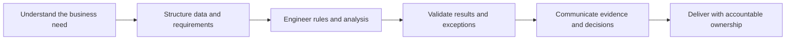
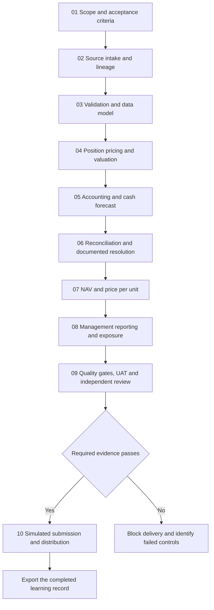
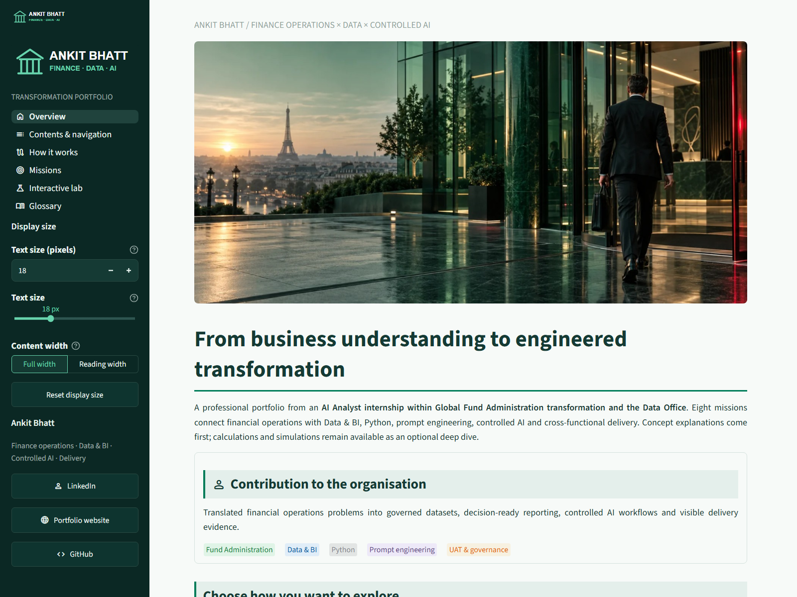
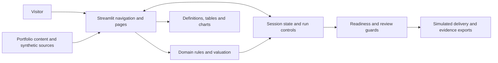
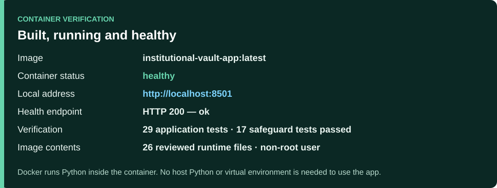
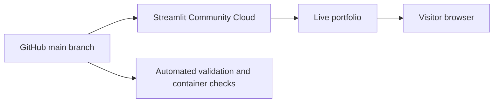

# Finance · Data · AI

## Institutional Transformation Vault — Ankit Bhatt

**From financial operations to structured data, explainable calculations and controlled delivery.**


*Illustrative image used on the application's Overview page.*

This portfolio connects Ankit Bhatt's AI Analyst internship missions in Global Fund Administration transformation and the Data Office with interactive demonstrations of the underlying methods. It explains the business problem, the information required, the processing rule, the control and the resulting decision.

Explore **eight professional missions**, follow **one fictional fund through ten connected stages**, or inspect individual exercises across **14 pages**. Calculations include business definitions, worked explanations and downstream implications.

**[Open the live portfolio →](https://ankit-finance-data-ai.streamlit.app/)** · [Professional Knowledge and Contribution Guide](PROFESSIONAL_KNOWLEDGE_GUIDE.md)

Hosted on Streamlit Community Cloud. Explore the application directly in your browser, or run it locally with Docker.

**Run with Docker — no host Python or virtual environment required:** install Docker Desktop, start its Linux container engine, then run this command from the downloaded or cloned project folder:

```bash
docker compose up --build --detach --wait
```

Open **http://localhost:8501**. Docker installs Python and the dependencies inside the image. For subsequent starts with an existing image, use `docker compose up --detach --wait`; rebuild after source or dependency changes.

[Run the application](#installation-and-startup) · [Follow the guided case](#first-use-walkthrough) · [Live application](#live-application-and-deployment) · [Professional Knowledge and Contribution Guide](PROFESSIONAL_KNOWLEDGE_GUIDE.md)

## Contents

1. [Purpose and contribution](#purpose-and-contribution)
2. [The connected operating model](#the-connected-operating-model)
3. [Application content and navigation](#application-content-and-navigation)
4. [Requirements](#requirements)
5. [Installation and startup](#installation-and-startup)
6. [First-use walkthrough](#first-use-walkthrough)
7. [Example workflows](#example-workflows)
8. [Inputs, exports and session behaviour](#inputs-exports-and-session-behaviour)
9. [Architecture and project structure](#architecture-and-project-structure)
10. [Configuration and presentation](#configuration-and-presentation)
11. [Validation and testing](#validation-and-testing)
12. [Containers and team development](#containers-and-team-development)
13. [Live application and deployment](#live-application-and-deployment)
14. [Troubleshooting](#troubleshooting)
15. [Scope, attribution and maintenance](#scope-attribution-and-maintenance)

## Purpose and contribution

A valuation needs reliable records, consistent dates, understandable rules, documented exceptions and approval of the correct version. Transformation work makes these relationships explicit so that operational processes can be improved and their results assessed.



| Mission | Contribution presented in the portfolio |
| --- | --- |
| Data engineering and transformation | Structure source exports, preserve lineage and reconcile processing totals. |
| Power BI and reconciliation analytics | Distinguish fund entities from operational events and define reporting measures. |
| Prompt engineering and LLM automation | Bound the task, specify structured outputs and apply schedule-aware checks with review of exceptions. |
| Python and GUI tool development | Translate repetitive operational requirements into usable processing tools. |
| Financial process automation | Map confirmation fields and product rules into structured, reviewable outputs. |
| AI governance and global stakeholder management | Clarify ownership, evidence, risk and decision criteria across business and technical stakeholders. |
| Anomaly detection and risk prioritization | Separate source defects from business exceptions and make review rules explainable. |
| Cross-functional mission delivery | Connect requirements, proof of concept, UAT, blockers, readiness and handover. |

The mission descriptions represent documented experience supplied for the portfolio. Synthetic amounts, simulated identities and teaching examples demonstrate methods; they are not measured employer outcomes. The [Professional Knowledge and Contribution Guide](PROFESSIONAL_KNOWLEDGE_GUIDE.md) develops the contribution narrative and supporting technical concepts.

## The connected operating model

The guided case follows **Aurora Equity Fund** for **17 September 2026**. Each stage consumes evidence produced by completed stages.



The baseline reconstructs **EUR 475,000,000 of investments**, **EUR 474,993,493 of Net Asset Value (NAV)** and **EUR 118.7484 per unit**. Expected movements produce **EUR 20,551,700 projected cash**, tested against an illustrative **EUR 360,000 reserve**. Forecast cash supports liquidity planning; NAV retains the accounting cash balance.

The Professional Knowledge and Contribution Guide distinguishes this **ten-stage educational case**, the **ten-stage operational NAV lifecycle**, and the **twelve-step technical valuation model**. They describe different levels of the process.

## Application content and navigation

**Contents & navigation**, immediately after Overview in the sidebar, contains the full numbered index and a clickable route diagram. Within pages, selected tabs are green. Mission methods, decisions, controls and evidence are permanently visible without opening a parent panel.

| Page | Content |
| --- | --- |
| Overview | Professional context, contribution, capabilities and entry points. |
| Contents & navigation | Complete index, topic descriptions and navigation diagram. |
| How the work fits together | Fund Administration, NAV lifecycle, delivery, data modelling and prompt-engineering concepts. |
| Missions | Eight workstreams, methods, decisions, controls, evidence and delivery simulators. |
| Interactive lab | Entry points for the guided case and individual workbenches. |
| Guided case | Ten sequential stages, carried evidence and a final JSON export. |
| Business and operating model | Service responsibilities, route selection and straight-through processing estimates. |
| Fund accounting | NAV equation, journals, performance fees, basis points and source records. |
| Net Asset Value control room | Scenarios, positions, valuation results, cash forecast and readiness checks. |
| Reconciliation workbench | Source comparisons, investigation, dispositions and accounting corrections. |
| Data and Business Intelligence | Event metrics, fund counts, CSV consolidation, dimensional modelling and anomaly rules. |
| Controlled Artificial Intelligence | Rule-based confirmation extraction, completion-date checks and CSV splitting. |
| Delivery and governance | Preparer/checker review, queries, deadlines, recipient outcomes, recovery planning and UAT. |
| Glossary and methodology | Searchable terminology and abbreviations by subject. |

**Reading preferences:** under **Display size**, use **Text size (pixels)** or the synchronised **Text size** slider to choose **12–32 px** in one-pixel increments; the default is **18 px**. Both **Full width** and **Reading width** remain visible. **Reset display size** restores the defaults. Preferences carry across pages in the current session.

Result cards use blue emphasis; warnings and failed control outcomes use red. Read-only tables wrap long text and alternate row shading. Editable grids include a complete record view beneath them.



*Current Overview showing navigation, adjustable display settings and the professional contribution summary. This screenshot illustrates the interface; automated checks are described separately below.*

## Requirements

**Choose one execution route.** Docker users need Docker with Compose and a browser; they do not need Python, pip or a virtual environment on the host. Python requirements apply to a native installation, or are installed automatically inside the container.

| Requirement | Purpose |
| --- | --- |
| Python 3.11 | Native route only: recommended clean-install target. CI and the container also use Python 3.11 internally. |
| pip | Native route only: Python dependency installation. |
| A modern browser | Local or hosted application access. |
| Streamlit `1.66.1` | Application framework and controls. |
| pandas `2.3.3` | Data structures and tables. |
| Altair `6.3.0` | Reporting and valuation charts. |
| Git, optional for local use | Source versioning and publication to a connected host. |
| Docker with Compose v2 | Docker route: Docker Desktop with Linux containers on Windows/macOS, or Docker Engine with Compose on Linux. |

Dependencies are declared in [requirements.txt](institutional_streamlit_portfolio/requirements.txt). Internet access is needed for package installation, external profile links and hosting setup. Current calculations, sample data, parsing and anomaly rules need **no API key, model download, paid service or financial-system account**.

## Installation and startup

Initial commands assume a terminal at the **repository root**: the folder containing `Dockerfile` and `compose.yaml`.

### Recommended: Docker, without host Python

1. Download/extract the project or clone it with Git. Keep `compose.yaml`, `Dockerfile` and the application directory together.
2. Install and start Docker Desktop with Linux containers, or start Docker Engine on Linux. Confirm readiness with `docker version`.
3. Open a terminal in the project root and run:

```bash
docker compose up --build --detach --wait
docker compose ps
```

4. Confirm the status is **healthy**, then open **http://localhost:8501**. The health URL is **http://localhost:8501/_stcore/health**, which should return `ok`.
5. Stop the application with `docker compose down`. Detached containers continue running after the terminal closes; Docker itself must remain running.

The first build downloads the base image and dependencies. Later starts reuse the local image. This route builds the application directly from the source on your computer.

### Optional: native Python installation

The following alternatives require host Python. The commands start Streamlit from `institutional_streamlit_portfolio`. Keep that terminal open; **Ctrl+C** stops its server. Docker users can skip these alternatives.

### Windows launcher

With a working Python 3.11 installation:

```powershell
.\institutional_streamlit_portfolio\run_windows.bat
```

The launcher checks project environments, installs dependencies when needed and starts the app. It searches **8501–8599** for an available port, prints the actual URL and normally opens the browser. To override these defaults before launch:

```powershell
$env:VAULT_PORT = '8502'
$env:VAULT_OPEN_BROWSER = 'false'
.\institutional_streamlit_portfolio\run_windows.bat
```

### Windows: fresh manual installation

```powershell
py -3.11 -m venv .venv
.\.venv\Scripts\python.exe -m pip install -r institutional_streamlit_portfolio/requirements.txt
Set-Location institutional_streamlit_portfolio
..\.venv\Scripts\python.exe -m streamlit run app.py
```

Python 3.11 matches the deployed application and Docker image. Environment activation is unnecessary when calling its interpreter directly.

### Linux or macOS

Use an installed Python 3.11 interpreter:

```bash
python3.11 -m venv .venv
.venv/bin/python -m pip install -r institutional_streamlit_portfolio/requirements.txt
cd institutional_streamlit_portfolio
../.venv/bin/python -m streamlit run app.py
```

Open **http://localhost:8501** for a manual launch. If occupied, append `--server.port=8502`. Always use the address printed by the process you started.

## First-use walkthrough

1. Review the scope notice. Select **Educational scope understood; only non-confidential example data will be used.**, then **Enter portfolio**. This acknowledges scope; it is not authentication.
2. Open **Contents & navigation**. Select **Missions** to review professional work, or follow the fictional case below.
3. Open **Interactive lab**, keep **Guided case** selected and select **Start the guided case**.
4. Select **Run next stage** ten times, reviewing each stage before advancing. The case supplies all financial inputs.
5. Inspect definitions, formulas, source references and results. Reporting explains why six event records can belong to one fund.
6. Select **Download the completed learning record** after the final stage to retain the JSON evidence.
7. Use **Restart the guided journey** only when ready to clear its progress. Open another workbench from the index for independent analysis.

## Example workflows

### Trace a valuation result

Follow position valuation, accounting/cash and NAV in the guided case. Compare reconstructed investments with the accounting investment balance. Inspect projected cash separately from ledger cash, then trace assets and liabilities to price per unit. Completed-stage panels retain the supporting explanation and evidence.

### Assess cash stress

In **Net Asset Value control room**, select **Large redemption and cash stress** under **Valuation scenario**, then **Apply scenario inputs**. Calculate the draft and inspect **Read the result**. This example triggers a downward swing under the teaching policy and a projected overdraft. Readiness checks still govern progression; valid arithmetic is not approval for release.

### Investigate a correction

In **Reconciliation workbench**, choose **Current valuation run**, select an exception and compare the three records. Supply the confirmed cause, action, accountable owner and evidence reference. An accounting correction changes the relevant input and requires recalculation. Other dispositions can invalidate review while retaining the calculation. Return to NAV readiness before preparer/checker review.

### Interpret operational reporting

In **Data and Business Intelligence**, filter to one fund and read its event descriptions. The sample contains **24 events across four funds**, six per fund. The independent reporting sample initially has four matched Aurora events out of six; the guided case carries its own resolution forward and reports five out of six. Filters change the population and denominator. An amount under investigation is not automatically a loss.

### Inspect controlled automation

In **Controlled Artificial Intelligence**, select a confirmation template and **Run controlled extraction**. Inspect completeness, missing fields, validation errors and mapped evidence. Change or omit a field and rerun to see the review route. This parser uses explicit rules; it does not call an LLM. Other tabs assess completion dates and split CSV data with a reconciliation manifest.

## Inputs, exports and session behaviour

| Feature | Input and constraints | Output |
| --- | --- | --- |
| Guided case | Prepared synthetic records; no financial entry. | Completed journey JSON. |
| NAV workbench | Accounting, unit, flow and policy figures; editable holdings and fund/date context. | Draft valuation, cash forecast and control results. |
| Journal exercise | Event, positive amount and reference. | Balanced session journal, separate from the NAV calculator. |
| CSV consolidation | One or more CSVs; UTF-8 BOM, UTF-8, CP1252 and Latin-1 decoding attempts. Reserved lineage columns cannot be source fields. | Traceable master CSV and intake checks. |
| Confirmation parser | Semicolon-separated `KEY=VALUE` fields; futures or FX-swap template. | Structured payload, evidence and review route. |
| Completion-date batch | Seven-column CSV below; maximum **10 MB** and **10,000 rows**. | Assessed schedule CSV with source issues identified. |
| CSV splitter | UTF-8 CSV, nonempty header, consistent field count; maximum **10 MB**. | ZIP of sequential parts plus manifest. |
| Governance export | Current run, calculations, exceptions and review evidence. | JSON evidence package; no restore/import workflow. |

The batch schedule template is downloadable in the app:

```text
Fund,Valuation frequency,Valuation date,Expected completion date,Actual or forecast completion date,Tolerance (calendar days),Schedule evidence reference
```

Dates use `YYYY-MM-DD`. Frequency is Daily, Weekly, Monthly or Quarterly; tolerance is a nonnegative whole number. The exercise uses supplied calendar dates rather than a complete business-day and intraday calendar engine.

**Persistence:** edits, journals, approvals and preferences reside in temporary Streamlit session state. Navigation retains the current session, but new sessions, server restarts or disconnections may lose it. There is no database-backed save, backup or restore. Downloads support offline review; they do not restore the app. Changing the valuation fund/date reseeds that run. Restarting the guided journey clears its progress, and clearing the illustrative journal removes its session entries.

CSV quoting and byte layout can be normalised during rewriting. Consolidation flags potential duplicates without automatically deleting repeated records. Use small non-confidential samples; wrapped reference tables are intended for review rather than large-scale data browsing.

## Architecture and project structure



```text
.
├── README.md                         # Complete project guide
├── PROFESSIONAL_KNOWLEDGE_GUIDE.md  # Knowledge synthesis and professional contribution
├── docs/screenshots/                 # Current interface illustration
├── .github/workflows/ci.yml          # Validation, container checks and image publication
├── Dockerfile
├── compose.yaml
├── compose.dev.yaml
└── institutional_streamlit_portfolio/
    ├── app.py                       # Entry point, sidebar and page registration
    ├── data.py                      # Profile, missions, glossary and synthetic datasets
    ├── domain.py                    # Cash, fees, journals, parsing and rule helpers
    ├── valuation.py                 # NAV, unit price and illustrative swing rule
    ├── state.py                     # Session lifecycle, invalidation and exports
    ├── learning.py                  # Business definitions and worked explanations
    ├── ui.py                        # Cards, wrapped tables and chart presentation
    ├── styles.py                    # Visual rules and reading preferences
    ├── app_pages/                   # Fourteen pages, including the content index
    ├── assets/                      # Logo and hero image
    ├── .streamlit/config.toml       # Native theme and application settings
    ├── requirements.txt
    ├── run_windows.bat
    ├── validate.py
    └── test_workflows.py
```

The guided journey owns its staged records. NAV, reconciliation and governance share a separate valuation run. Other tools, including journals and CSV exercises, are separate demonstrations; not every page automatically feeds every other page.

## Configuration and presentation

| Change | Location |
| --- | --- |
| Visitor reading preferences | **Display size** in the sidebar. |
| Theme, font defaults and server settings | [config.toml](institutional_streamlit_portfolio/.streamlit/config.toml) |
| Highlighting, wrapping, tabs and controls | [styles.py](institutional_streamlit_portfolio/styles.py), [ui.py](institutional_streamlit_portfolio/ui.py) |
| Professional content and sample records | [data.py](institutional_streamlit_portfolio/data.py) |
| Financial and processing rules | [domain.py](institutional_streamlit_portfolio/domain.py), [valuation.py](institutional_streamlit_portfolio/valuation.py) |
| Guided stages and evidence | [guided_pipeline.py](institutional_streamlit_portfolio/app_pages/guided_pipeline.py) |
| Definitions and interpretation | [learning.py](institutional_streamlit_portfolio/learning.py) |
| Listening port | `--server.port`, launcher `VAULT_PORT`, or Compose `APP_PORT`. |

Some visual rules target Streamlit's frontend structure. Dependency upgrades require manual checks of alignment, controls, wrapping and narrow-screen behaviour as well as automated tests.

## Validation and testing

From the application directory, using a `.venv` at the repository root:

```powershell
# Windows PowerShell
..\.venv\Scripts\python.exe validate.py
..\.venv\Scripts\python.exe -m unittest test_workflows.py -v
```

```bash
# Linux / macOS
../.venv/bin/python validate.py
../.venv/bin/python -m unittest test_workflows.py -v
```

Validation covers syntax, page registration, content and domain behaviour. Unittests cover calculations and Streamlit interactions, including the guided journey, correction/review invalidation, navigation and display settings. Successful commands end with **VALIDATION PASSED** and **OK**.

**Validation:** the application suite contains **32 tests**, covering financial calculations, all registered pages, the guided case, exception visibility, correction handling, read-only controls and review invalidation. Structural validation also checks page registration and content. The Docker image has been built and health-checked; the repository includes **17 additional safeguard tests**.

## Containers and team development



*Verification summary prepared from the successful local build, health checks and test runs. It records the verified result; it is not a live status indicator.*

With Docker running and Linux containers enabled, execute from the repository root:

```bash
docker compose up --build -d --wait
docker compose logs -f app
```

Open **http://localhost:8501**. The image uses Python 3.11, a non-root user, port 8501 and `/_stcore/health`. Compose publishes on localhost. To stop and remove this project's containers:

```bash
docker compose down
```

The verified local image is `institutional-vault-app:latest`; Compose runs it as `institutional-vault-app-1`. Check its readiness with `docker compose ps` and visit `http://localhost:8501/_stcore/health`. The runtime image intentionally excludes tests and the Windows launcher; run the tests with the development mount, in CI, or by mounting only those reviewed files into a disposable container.

For live local source edits:

```bash
docker compose -f compose.yaml -f compose.dev.yaml up --build
```

The override mounts the application directory read-only, enables run-on-save and polls for changes. Rebuild after dependency changes. Check the development container with:

```bash
docker compose -f compose.yaml -f compose.dev.yaml exec app python validate.py
docker compose -f compose.yaml -f compose.dev.yaml exec app python -m unittest test_workflows.py -v
```

For a different port, set `$env:APP_PORT = '8502'` in PowerShell or `export APP_PORT=8502` in a POSIX shell before starting Compose.

## Live application and deployment

**[Open Finance · Data · AI Portfolio](https://ankit-finance-data-ai.streamlit.app/)**

The application is hosted on **Streamlit Community Cloud**, connected to this repository's `main` branch. Source updates pushed to that branch are picked up by Streamlit automatically.



| Deployment setting | Value |
| --- | --- |
| Platform | Streamlit Community Cloud |
| Live URL | [ankit-finance-data-ai.streamlit.app](https://ankit-finance-data-ai.streamlit.app/) |
| Repository | [abskyblu-create/BNP_AI_Analyst_Transformation_Portfolio](https://github.com/abskyblu-create/BNP_AI_Analyst_Transformation_Portfolio) |
| Branch | `main` |
| Entry point | `institutional_streamlit_portfolio/app.py` |
| Python | 3.11 |
| Dependencies | [requirements.txt](institutional_streamlit_portfolio/requirements.txt) |
| API keys | None required |

Automated checks validate application behaviour, container health and repository safety as part of the development workflow.

## Troubleshooting

| Symptom | Action |
| --- | --- |
| Windows does not recognise `python` | Use `py -3.11` or a verified environment's `python.exe`. |
| `No Python at ...` | The environment points to a missing installation. Create a new environment with a working interpreter; retain the source. |
| Missing module or unsupported widget parameter | Install the pinned requirements with the same interpreter used to start the app. |
| Missing images or different theme | Confirm the application assets and `.streamlit/config.toml` are present in the checkout. |
| Port 8501 occupied | Use the launcher's printed address or specify another port. Confirm the browser is not showing an older instance. |
| Changes not visible | Confirm the local port or deployed version. Rerun Streamlit or enable rerun-on-save; a local edit is not a cloud deployment. |
| Review/publication button disabled | Complete readiness, exception dispositions and current preparer/checker evidence; resolve open client queries. |
| CSV rejected | Check the relevant encoding, headers, dates, field counts and tool-specific limits. |
| Session reset | State is temporary. Prior downloads support review but cannot be imported as a restored session. |
| Docker configuration or connection error | Start Docker Desktop with Linux containers and check user permissions. Valid Compose syntax does not prove a running container. |

## Scope, attribution and maintenance

This is an educational portfolio, with no live market feed, trading/payment connection, authenticated maker/checker identities or external delivery integration. Automation exercises use deterministic parsing, calendar and decision rules. Fingerprints support change detection; they are not digital signatures or immutable audit records. Simplified valuation and fee rules do not cover every instrument, allocation or governing-document provision.

The material is educational and does not provide investment, accounting, legal or regulatory advice.

Professional narratives draw on internship and experience material. Employer endorsement is not implied. Interactive exercises use fictional funds, figures and workflow actors; use non-confidential example data.

This is the authoritative project README; the [Professional Knowledge and Contribution Guide](PROFESSIONAL_KNOWLEDGE_GUIDE.md) is the companion professional reference. Update both when calculations, interface labels or deployment status change. Review upgrades through tests and manual presentation checks. The project source is available under the [MIT License](LICENSE); third-party materials remain subject to their respective terms.

**Author:** Ankit Bhatt · [LinkedIn](https://www.linkedin.com/in/ankit-bhatt-4a1631388/) · [GitHub](https://github.com/abskyblu-create) · [Personal website](https://resume-s3th.onrender.com)
