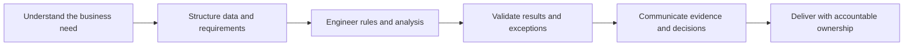
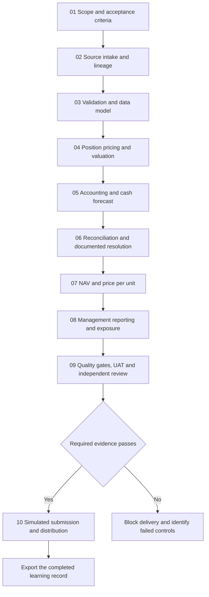
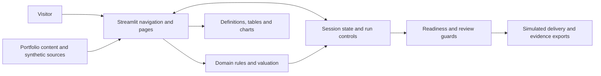
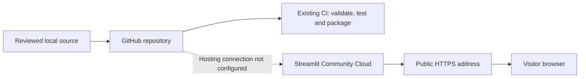

# Finance · Data · AI

## Institutional Transformation Vault — Ankit Bhatt

**From financial operations to structured data, explainable calculations and controlled delivery.**


*Illustrative image used on the application's Overview page.*

This portfolio connects Ankit Bhatt's AI Analyst internship missions in Global Fund Administration transformation and the Data Office with interactive demonstrations of the underlying methods. It explains the business problem, the information required, the processing rule, the control and the resulting decision.

Explore **eight professional missions**, follow **one fictional fund through ten connected stages**, or inspect individual exercises across **14 pages**. Calculations include business definitions, worked explanations and downstream implications.

**Status:** Docker image built and local container health-checked. Public hosting and a live portfolio URL have not been configured. Professional mission narratives and fictional demonstration results are identified separately.

**Run with Docker — no host Python or virtual environment required:** install Docker Desktop, start its Linux container engine, then run this command from the downloaded or cloned project folder:

```bash
docker compose up --build --detach --wait
```

Open **http://localhost:8501**. Docker installs Python and the dependencies inside the image. For subsequent starts with an existing image, use `docker compose up --detach --wait`; rebuild after source or dependency changes.

[Run the application](#installation-and-startup) · [Follow the guided case](#first-use-walkthrough) · [Hosting](#public-hosting-and-continuous-deployment) · [Professional Knowledge and Contribution Guide](PROFESSIONAL_KNOWLEDGE_GUIDE.md)

## Contents

1. [Purpose and contribution](#purpose-and-contribution)
2. [The connected operating model](#the-connected-operating-model)
3. [Application content and navigation](#application-content-and-navigation)
4. [Requirements](#requirements)
5. [Installation and startup](#installation-and-startup)
6. [First-use walkthrough](#first-use-walkthrough)
7. [Example workflows](#example-workflows)
8. [Inputs, exports and session behaviour](#inputs-exports-and-session-behaviour)
9. [Architecture and project structure](#architecture-and-project-structure)
10. [Configuration and presentation](#configuration-and-presentation)
11. [Validation and testing](#validation-and-testing)
12. [Containers and team development](#containers-and-team-development)
13. [Public hosting and continuous deployment](#public-hosting-and-continuous-deployment)
14. [Publication safeguards](#publication-safeguards)
15. [Troubleshooting](#troubleshooting)
16. [Scope, attribution and maintenance](#scope-attribution-and-maintenance)

## Purpose and contribution

A valuation needs reliable records, consistent dates, understandable rules, documented exceptions and approval of the correct version. Transformation work makes these relationships explicit so that operational processes can be improved and their results assessed.



| Mission | Contribution presented in the portfolio |
| --- | --- |
| Data engineering and transformation | Structure source exports, preserve lineage and reconcile processing totals. |
| Power BI and reconciliation analytics | Distinguish fund entities from operational events and define reporting measures. |
| Prompt engineering and LLM automation | Bound the task, specify structured outputs and apply schedule-aware checks with review of exceptions. |
| Python and GUI tool development | Translate repetitive operational requirements into usable processing tools. |
| Financial process automation | Map confirmation fields and product rules into structured, reviewable outputs. |
| AI governance and global stakeholder management | Clarify ownership, evidence, risk and decision criteria across business and technical stakeholders. |
| Anomaly detection and risk prioritization | Separate source defects from business exceptions and make review rules explainable. |
| Cross-functional mission delivery | Connect requirements, proof of concept, UAT, blockers, readiness and handover. |

The mission descriptions represent documented experience supplied for the portfolio. Synthetic amounts, simulated identities and teaching examples demonstrate methods; they are not measured employer outcomes. The [Professional Knowledge and Contribution Guide](PROFESSIONAL_KNOWLEDGE_GUIDE.md) develops the contribution narrative and supporting technical concepts.

## The connected operating model

The guided case follows **Aurora Equity Fund** for **17 September 2026**. Each stage consumes evidence produced by completed stages.



The baseline reconstructs **EUR 475,000,000 of investments**, **EUR 474,993,493 of Net Asset Value (NAV)** and **EUR 118.7484 per unit**. Expected movements produce **EUR 20,551,700 projected cash**, tested against an illustrative **EUR 360,000 reserve**. Forecast cash supports liquidity planning; NAV retains the accounting cash balance.

The interview guide distinguishes this **ten-stage educational case**, the **ten-stage operational NAV lifecycle**, and the **twelve-step technical valuation model**. They describe different levels of the process.

## Application content and navigation

**Contents & navigation**, immediately after Overview in the sidebar, contains the full numbered index and a clickable route diagram. Within pages, selected tabs are green. Mission methods, decisions, controls and evidence are permanently visible without opening a parent panel.

| Page | Content |
| --- | --- |
| Overview | Professional context, contribution, capabilities and entry points. |
| Contents & navigation | Complete index, topic descriptions and navigation diagram. |
| How the work fits together | Fund Administration, NAV lifecycle, delivery, data modelling and prompt-engineering concepts. |
| Missions | Eight workstreams, methods, decisions, controls, evidence and delivery simulators. |
| Interactive lab | Entry points for the guided case and individual workbenches. |
| Guided case | Ten sequential stages, carried evidence and a final JSON export. |
| Business and operating model | Service responsibilities, route selection and straight-through processing estimates. |
| Fund accounting | NAV equation, journals, performance fees, basis points and source records. |
| Net Asset Value control room | Scenarios, positions, valuation results, cash forecast and readiness checks. |
| Reconciliation workbench | Source comparisons, investigation, dispositions and accounting corrections. |
| Data and Business Intelligence | Event metrics, fund counts, CSV consolidation, dimensional modelling and anomaly rules. |
| Controlled Artificial Intelligence | Rule-based confirmation extraction, completion-date checks and CSV splitting. |
| Delivery and governance | Preparer/checker review, queries, deadlines, recipient outcomes, recovery planning and UAT. |
| Glossary and methodology | Searchable terminology and abbreviations by subject. |

**Reading preferences:** under **Display size**, use **Text size (pixels)** or the synchronised **Text size** slider to choose **12–32 px** in one-pixel increments; the default is **18 px**. Both **Full width** and **Reading width** remain visible. **Reset display size** restores the defaults. Preferences carry across pages in the current session.

Result cards use blue emphasis; warnings and failed control outcomes use red. Read-only tables wrap long text and alternate row shading. Editable grids include a complete record view beneath them.


*Current Overview showing navigation, adjustable display settings and the professional contribution summary. This screenshot illustrates the interface; automated checks are described separately below.*

## Requirements

**Choose one execution route.** Docker users need Docker with Compose and a browser; they do not need Python, pip or a virtual environment on the host. Python requirements apply to a native installation, or are installed automatically inside the container.

| Requirement | Purpose |
| --- | --- |
| Python 3.11 or newer | Native route only: recommended clean-install target. CI and the container also use Python 3.11 internally. |
| pip | Native route only: Python dependency installation. |
| A modern browser | Local or hosted application access. |
| Streamlit `>=1.64,<2.0` | Application framework and controls. |
| pandas `>=2.2,<3.0` | Data structures and tables. |
| Altair `>=5.5,<7.0` | Reporting and valuation charts. |
| Git, optional for local use | Source versioning and publication to a connected host. |
| Docker with Compose v2 | Docker route: Docker Desktop with Linux containers on Windows/macOS, or Docker Engine with Compose on Linux. |

Dependencies are declared in [requirements.txt](institutional_streamlit_portfolio/requirements.txt). Internet access is needed for package installation, external profile links and hosting setup. Current calculations, sample data, parsing and anomaly rules need **no API key, model download, paid service or financial-system account**.

## Installation and startup

Initial commands assume a terminal at the **repository root**: the folder containing `Dockerfile` and `compose.yaml`.

### Recommended: Docker, without host Python

1. Download/extract the project or clone it with Git. Keep `compose.yaml`, `Dockerfile` and the application directory together.
2. Install and start Docker Desktop with Linux containers, or start Docker Engine on Linux. Confirm readiness with `docker version`.
3. Open a terminal in the project root and run:

```bash
docker compose up --build --detach --wait
docker compose ps
```

4. Confirm the status is **healthy**, then open **http://localhost:8501**. The health URL is **http://localhost:8501/_stcore/health**, which should return `ok`.
5. Stop the application with `docker compose down`. Detached containers continue running after the terminal closes; Docker itself must remain running.

The first build downloads the base image and dependencies. Later starts reuse the local image. An image registry is not connected yet, so another machine must currently obtain this source and build it; `institutional-vault-app:latest` is not a published download.

### Optional: native Python installation

The following alternatives require host Python. Start Streamlit from `institutional_streamlit_portfolio` so current relative assets and theme settings resolve correctly. Keep that terminal open; **Ctrl+C** stops its server. Docker users can skip these alternatives.

### Windows launcher

With a working Python 3.11+ installation:

```powershell
.\institutional_streamlit_portfolio\run_windows.bat
```

The launcher checks project environments, installs dependencies when needed and starts the app. It searches **8501–8599** for an available port, prints the actual URL and normally opens the browser. To override these defaults before launch:

```powershell
$env:VAULT_PORT = '8502'
$env:VAULT_OPEN_BROWSER = 'false'
.\institutional_streamlit_portfolio\run_windows.bat
```

### Windows: fresh manual installation

```powershell
py -3.11 -m venv .venv
.\.venv\Scripts\python.exe -m pip install -r institutional_streamlit_portfolio/requirements.txt
Set-Location institutional_streamlit_portfolio
..\.venv\Scripts\python.exe -m streamlit run app.py
```

Use `py -3.12` instead if that is your installed version. Environment activation is unnecessary when calling its interpreter directly.

### Linux or macOS

Use an installed Python 3.11+ interpreter:

```bash
python3 -m venv .venv
.venv/bin/python -m pip install -r institutional_streamlit_portfolio/requirements.txt
cd institutional_streamlit_portfolio
../.venv/bin/python -m streamlit run app.py
```

Open **http://localhost:8501** for a manual launch. If occupied, append `--server.port=8502`. Always use the address printed by the process you started.

### Existing development workspace

An ignored `.runtime_venv` also exists in the current workspace. If its interpreter works, run directly from the application directory:

```powershell
Set-Location institutional_streamlit_portfolio
..\.runtime_venv\Scripts\python.exe -m streamlit run app.py
```

From the repository root, inspect it with:

```powershell
.\.runtime_venv\Scripts\python.exe --version
.\.runtime_venv\Scripts\python.exe -m pip show streamlit pandas altair
```

The existing verification runtime reports Python **3.10.18**, Streamlit **1.64.0**, pandas **2.3.3** and Altair **6.2.2**. It runs the current checks but falls below the launcher's Python minimum. Use Python 3.11+ for fresh project installations; virtual environments are local dependencies and should not be copied between computers.

## First-use walkthrough

1. Review the scope notice. Select **Educational scope understood; only non-confidential example data will be used.**, then **Enter portfolio**. This acknowledges scope; it is not authentication.
2. Open **Contents & navigation**. Select **Missions** to review professional work, or follow the fictional case below.
3. Open **Interactive lab**, keep **Guided case** selected and select **Start the guided case**.
4. Select **Run next stage** ten times, reviewing each stage before advancing. The case supplies all financial inputs.
5. Inspect definitions, formulas, source references and results. Reporting explains why six event records can belong to one fund.
6. Select **Download the completed learning record** after the final stage to retain the JSON evidence.
7. Use **Restart the guided journey** only when ready to clear its progress. Open another workbench from the index for independent analysis.

## Example workflows

### Trace a valuation result

Follow position valuation, accounting/cash and NAV in the guided case. Compare reconstructed investments with the accounting investment balance. Inspect projected cash separately from ledger cash, then trace assets and liabilities to price per unit. Completed-stage panels retain the supporting explanation and evidence.

### Assess cash stress

In **Net Asset Value control room**, select **Large redemption and cash stress** under **Valuation scenario**, then **Apply scenario inputs**. Calculate the draft and inspect **Read the result**. This example triggers a downward swing under the teaching policy and a projected overdraft. Readiness checks still govern progression; valid arithmetic is not approval for release.

### Investigate a correction

In **Reconciliation workbench**, choose **Current valuation run**, select an exception and compare the three records. Supply the confirmed cause, action, accountable owner and evidence reference. An accounting correction changes the relevant input and requires recalculation. Other dispositions can invalidate review while retaining the calculation. Return to NAV readiness before preparer/checker review.

### Interpret operational reporting

In **Data and Business Intelligence**, filter to one fund and read its event descriptions. The sample contains **24 events across four funds**, six per fund. The independent reporting sample initially has four matched Aurora events out of six; the guided case carries its own resolution forward and reports five out of six. Filters change the population and denominator. An amount under investigation is not automatically a loss.

### Inspect controlled automation

In **Controlled Artificial Intelligence**, select a confirmation template and **Run controlled extraction**. Inspect completeness, missing fields, validation errors and mapped evidence. Change or omit a field and rerun to see the review route. This parser uses explicit rules; it does not call an LLM. Other tabs assess completion dates and split CSV data with a reconciliation manifest.

## Inputs, exports and session behaviour

| Feature | Input and constraints | Output |
| --- | --- | --- |
| Guided case | Prepared synthetic records; no financial entry. | Completed journey JSON. |
| NAV workbench | Accounting, unit, flow and policy figures; editable holdings and fund/date context. | Draft valuation, cash forecast and control results. |
| Journal exercise | Event, positive amount and reference. | Balanced session journal, separate from the NAV calculator. |
| CSV consolidation | One or more CSVs; UTF-8 BOM, UTF-8, CP1252 and Latin-1 decoding attempts. Reserved lineage columns cannot be source fields. | Traceable master CSV and intake checks. |
| Confirmation parser | Semicolon-separated `KEY=VALUE` fields; futures or FX-swap template. | Structured payload, evidence and review route. |
| Completion-date batch | Seven-column CSV below; maximum **10 MB** and **10,000 rows**. | Assessed schedule CSV with source issues identified. |
| CSV splitter | UTF-8 CSV, nonempty header, consistent field count; maximum **10 MB**. | ZIP of sequential parts plus manifest. |
| Governance export | Current run, calculations, exceptions and review evidence. | JSON evidence package; no restore/import workflow. |

The batch schedule template is downloadable in the app:

```text
Fund,Valuation frequency,Valuation date,Expected completion date,Actual or forecast completion date,Tolerance (calendar days),Schedule evidence reference
```

Dates use `YYYY-MM-DD`. Frequency is Daily, Weekly, Monthly or Quarterly; tolerance is a nonnegative whole number. The exercise uses supplied calendar dates rather than a complete business-day and intraday calendar engine.

**Persistence:** edits, journals, approvals and preferences reside in temporary Streamlit session state. Navigation retains the current session, but new sessions, server restarts or disconnections may lose it. There is no database-backed save, backup or restore. Downloads support offline review; they do not restore the app. Changing the valuation fund/date reseeds that run. Restarting the guided journey clears its progress, and clearing the illustrative journal removes its session entries.

CSV quoting and byte layout can be normalised during rewriting. Consolidation flags potential duplicates without automatically deleting repeated records. Use small non-confidential samples; wrapped reference tables are intended for review rather than large-scale data browsing.

## Architecture and project structure



```text
.
├── README.md                         # Complete project guide
├── PROFESSIONAL_KNOWLEDGE_GUIDE.md  # Knowledge synthesis and professional contribution
├── docs/screenshots/                 # Current interface illustration
├── .github/workflows/ci.yml          # Validation, container checks and image publication
├── .gitlab-ci.yml                    # Alternative GitLab validation and packaging
├── .publication-policy.json         # Exact reviewed public paths and asset hashes
├── .gitleaks.toml                    # Offline secret rules extending Gitleaks defaults
├── .githooks/                        # Clone-local pre-commit and pre-push checks
├── scripts/                         # Safeguard setup, checks and synthetic tests
├── Dockerfile
├── compose.yaml
├── compose.dev.yaml
└── institutional_streamlit_portfolio/
    ├── app.py                       # Entry point, sidebar and page registration
    ├── data.py                      # Profile, missions, glossary and synthetic datasets
    ├── domain.py                    # Cash, fees, journals, parsing and rule helpers
    ├── valuation.py                 # NAV, unit price and illustrative swing rule
    ├── state.py                     # Session lifecycle, invalidation and exports
    ├── learning.py                  # Business definitions and worked explanations
    ├── ui.py                        # Cards, wrapped tables and chart presentation
    ├── styles.py                    # Visual rules and reading preferences
    ├── app_pages/                   # Fourteen pages, including the content index
    ├── assets/                      # Logo and hero image
    ├── .streamlit/config.toml       # Native theme and application settings
    ├── requirements.txt
    ├── run_windows.bat
    ├── validate.py
    └── test_workflows.py
```

The guided journey owns its staged records. NAV, reconciliation and governance share a separate valuation run. Other tools, including journals and CSV exercises, are separate demonstrations; not every page automatically feeds every other page.

## Configuration and presentation

| Change | Location |
| --- | --- |
| Visitor reading preferences | **Display size** in the sidebar. |
| Theme, font defaults and server settings | [config.toml](institutional_streamlit_portfolio/.streamlit/config.toml) |
| Highlighting, wrapping, tabs and controls | [styles.py](institutional_streamlit_portfolio/styles.py), [ui.py](institutional_streamlit_portfolio/ui.py) |
| Professional content and sample records | [data.py](institutional_streamlit_portfolio/data.py) |
| Financial and processing rules | [domain.py](institutional_streamlit_portfolio/domain.py), [valuation.py](institutional_streamlit_portfolio/valuation.py) |
| Guided stages and evidence | [guided_pipeline.py](institutional_streamlit_portfolio/app_pages/guided_pipeline.py) |
| Definitions and interpretation | [learning.py](institutional_streamlit_portfolio/learning.py) |
| Listening port | `--server.port`, launcher `VAULT_PORT`, or Compose `APP_PORT`. |

Some visual rules target Streamlit's frontend structure. Dependency upgrades require manual checks of alignment, controls, wrapping and narrow-screen behaviour as well as automated tests.

## Validation and testing

From the application directory, using a `.venv` at the repository root:

```powershell
# Windows PowerShell
..\.venv\Scripts\python.exe validate.py
..\.venv\Scripts\python.exe -m unittest test_workflows.py -v
```

```bash
# Linux / macOS
../.venv/bin/python validate.py
../.venv/bin/python -m unittest test_workflows.py -v
```

In the current workspace, substitute `..\.runtime_venv\Scripts\python.exe` for the Windows interpreter above.

Validation covers syntax, page registration, content and domain behaviour. Unittests cover calculations and Streamlit interactions, including the guided journey, correction/review invalidation, navigation and display settings. Successful commands end with **VALIDATION PASSED** and **OK**.

**Verification:** structural validation and the **29-test suite** passed locally and in disposable containers using the built application image. The runtime-only image was built successfully, started through Compose and reported **healthy** under its non-root user. Both `/_stcore/health` and the homepage returned HTTP 200 from the host; the health response was `ok`. An exported build-context audit matched exactly **26 reviewed runtime files**, excluding nested environments and unreviewed local files. The container resolved Python 3.11 with Streamlit 1.66.1, pandas 2.3.3 and Altair 6.3.0 from the declared ranges. Production and development Compose syntax was also checked. Cloud deployment remains unconfigured. The screenshot illustrates a local browser session, not visual validation of every screen or dependency version.

Before publishing visual changes, review all pages at small/large text sizes, narrow/wide viewports, keyboard focus, long cell values and warning states. Check that exports match the displayed run and external profile links reach their intended destination.

## Containers and team development


*Verification summary prepared from the successful local build, health checks and test runs. It records the verified result; it is not a live status indicator.*

With Docker running and Linux containers enabled, execute from the repository root:

```bash
docker compose up --build -d --wait
docker compose logs -f app
```

Open **http://localhost:8501**. The image uses Python 3.11, a non-root user, port 8501 and `/_stcore/health`. Compose publishes on localhost. To stop and remove this project's containers:

```bash
docker compose down
```

The verified local image is `institutional-vault-app:latest`; Compose runs it as `institutional-vault-app-1`. Check its readiness with `docker compose ps` and visit `http://localhost:8501/_stcore/health`. This is a local service, not a public hosting address. The runtime image intentionally excludes tests and the Windows launcher; run the tests with the development mount, in CI, or by mounting only those reviewed files into a disposable container.

For live local source edits:

```bash
docker compose -f compose.yaml -f compose.dev.yaml up --build
```

The override mounts the application directory read-only, enables run-on-save and polls for changes. Rebuild after dependency changes. Check the development container with:

```bash
docker compose -f compose.yaml -f compose.dev.yaml exec app python validate.py
docker compose -f compose.yaml -f compose.dev.yaml exec app python -m unittest test_workflows.py -v
```

For a different port, set `$env:APP_PORT = '8502'` in PowerShell or `export APP_PORT=8502` in a POSIX shell before starting Compose.

Repository owners manage collaborator access in GitHub or GitLab. Contributors should use feature branches, review their diff, validate/test and submit a pull or merge request. Keep reference documents and credentials outside publication allowlists. Protect the default branch with reviews and required checks where supported. Git history preserves reviewed source, not a visitor's live session.

For a repository that already has a remote, a typical contribution starts with `git switch -c feature/describe-your-change`. After validation, stage the intended files, commit and push that branch, then open a pull request. The GitHub checks are named **Publication safeguards**, **Validate application** and **Build and smoke test container**. Private source and container access are controlled separately by repository and package permissions.

## Public hosting and continuous deployment

**No live portfolio URL is claimed.** The external personal website linked in the app is a separate destination.

The proposed free route is GitHub source storage plus **Streamlit Community Cloud**, which runs dynamic Streamlit applications and provides a `streamlit.app` address. GitHub Pages and GitLab Pages serve static sites; this application requires a Python host. See [Community Cloud](https://docs.streamlit.io/deploy/streamlit-community-cloud).



Before deploying the current nested app:

1. Review the publication files, create a repository and connect the source to it.
2. Resolve root-directory paths for the logo and hero image, and verify theme loading. Community Cloud starts from the repository root; current local instructions start from the app subdirectory. Follow the [official file-organisation guidance](https://docs.streamlit.io/deploy/streamlit-community-cloud/deploy-your-app/file-organization).
3. Select the repository, branch and `institutional_streamlit_portfolio/app.py` entry point in Community Cloud. Choose the Python version deliberately and configure public access.
4. Verify pages, images, exports and run controls in the hosted environment before sharing its URL.

Once connected, pushes to the deployment branch update the app. CI alone does not establish that connection. Community Cloud has resource limits and sleeps after 12 hours without traffic; visitors can wake it. See [deployment](https://docs.streamlit.io/deploy/streamlit-community-cloud/deploy-your-app/deploy) and [management and limitations](https://docs.streamlit.io/deploy/streamlit-community-cloud/manage-your-app).

**GitHub workflow:** validates/tests, builds and health-checks a container, then publishes the tested default-branch image to `ghcr.io/<owner>/<repository>:<commit-sha>` and `:latest`. Only publication has package-write permission, using the automatic GitHub token. This delivers an image, not a deployed website.

**GitLab workflow:** validates/tests and packages a default-branch image in GitLab Container Registry. Its container job requires a runner supporting privileged, TLS-enabled Docker-in-Docker with shared client certificates. Registry and runner configuration must exist. A container host must support the app's port, WebSockets and public HTTPS.

Both CI definitions run **Publication safeguards** before application validation and packaging. They install the checksum-pinned scanner, check committed content and reachable history, and run the safeguard tests. CI operates after content has reached the remote; local hooks are the earlier control.

For an empty repository created in the chosen provider, publication is a separate action. Review the intended files and Git author identity first:

```bash
git status
git diff --cached --stat
git remote -v
```

Then stage only the intended source and documentation, create the reviewed commit, connect the actual repository URL and push the current branch. For a repository without an existing `origin`:

```bash
git remote add origin <your-repository-url>
git push -u origin HEAD
```

Replace the placeholder before executing. Authenticate through SSH or a credential manager; do not place tokens in a committed URL. These commands are instructions, not a record that publication or deployment has occurred.

## Publication safeguards

The exact public inventory is [`.publication-policy.json`](.publication-policy.json): application source, synthetic examples, two public guides, test/configuration files, CI definitions, safeguards and four reviewed visual assets. No document/image wildcard is used. [`.gitignore`](.gitignore) exposes only those paths; the guard independently rejects paths outside the inventory, even if force-added. [`.dockerignore`](.dockerignore) separately limits the container build context to runtime files.

The policy also identifies required safeguard files. They must be present in the staged or committed snapshot, not merely exist as untracked files, so an initial publication cannot silently omit its protective scripts, hooks or CI checks.

Private documents, original experience material, imported spreadsheets, real datasets, archives, exports, browser profiles, account configuration, environments, logs and credentials remain local. `.gitignore` does **not** remove content already in the index or history. Reviewed logo, hero and screenshot content is pinned by SHA-256; a changed or new asset requires visual review and a deliberate inventory update. Text secret detection cannot establish that an image is safe.

### Enable safeguards in each clone

Use the same working Python interpreter throughout. From the repository root on a fresh Windows setup:

```powershell
.\.venv\Scripts\python.exe scripts/setup_safeguards.py --enable-hooks
```

Linux/macOS:

```bash
.venv/bin/python scripts/setup_safeguards.py --enable-hooks
```

For this existing workspace, use `.\.runtime_venv\Scripts\python.exe` instead. Setup downloads **Gitleaks 8.30.1** from its [official release](https://github.com/gitleaks/gitleaks/releases/tag/v8.30.1), checks a pinned archive SHA-256, and installs it in ignored `.tools/`. Internet access is needed for installation only. Scans operate locally, make no credential-verification requests and do not upload findings. The [upstream project](https://github.com/gitleaks/gitleaks) describes future Gitleaks releases as security patches; review and deliberately update the pinned release and checksums when appropriate.

Setup configures only this clone's `core.hooksPath` and `hooks.publicationPython`; it does not change global Git settings. Check them with:

```bash
git config --local --get core.hooksPath
git config --local --get hooks.publicationPython
```

Git safeguards are a contributor/publisher task, separate from running the application. Docker users do not need these setup commands or host Python. Ignored virtual environments such as `.runtime_venv` do not accompany a new clone.

Hook activation has been verified in this development clone: `core.hooksPath` points to `.githooks`, and `hooks.publicationPython` points to its working interpreter. Other clones still require activation. For this existing workspace, run setup from your normal PowerShell terminal; the first command below avoids a relative-path `CommandNotFoundException`:

```powershell
Set-Location -LiteralPath 'C:\Users\Ankit\study\BNP_AI_Analyst_Transformation_Portfolio'
.\.runtime_venv\Scripts\python.exe scripts/setup_safeguards.py --hooks-only
```

Confirm the two local settings above before relying on automatic hook protection.

If hook activation fails, use `scripts/setup_safeguards.py --diagnose` with the same Python interpreter. This read-only check reports repository recognition, the presence of local configuration and any configuration lock. Setup distinguishes permission failures, existing locks, ownership checks and missing Git metadata; it never prints raw configuration or removes locks automatically. Running the application in Docker remains independent of hook activation.

If Git reports an ownership mismatch for this reviewed project, run the following in your normal user PowerShell terminal before retrying hook setup:

```powershell
git config --global --add safe.directory 'C:/Users/Ankit/study/BNP_AI_Analyst_Transformation_Portfolio'
```

For another checkout, substitute its exact absolute path only after verifying the owner and contents. This creates a path-specific trust exception in your user Git configuration; it does not change ownership, credentials or scanner rules. See Git's [safe.directory documentation](https://git-scm.com/docs/git-config#Documentation/git-config.txt-safedirectory). No global trust setting is changed automatically by the setup script.

If PowerShell still cannot locate that executable, check `Test-Path .\.runtime_venv\Scripts\python.exe`. A false result means this environment is absent from that checkout; use an existing installed Python, such as `py scripts/setup_safeguards.py --hooks-only`. The safeguard setup uses Python's standard library and needs no application-package installation. If the scanner is absent too, use `--enable-hooks` instead to install it and enable the hooks together.

If the scanner is already installed, `scripts/setup_safeguards.py --hooks-only` enables the hooks without another download. A moved/removed interpreter requires rerunning setup with a working one. Cloning the files alone does not enable hooks. Inspect existing hooks before changing `core.hooksPath` in an established clone; integrate existing checks rather than silently replacing them.

### Check before staging, committing or pushing

Using the project environment's Python, these scopes have distinct meanings:

```bash
python scripts/publication_guard.py worktree
python scripts/publication_guard.py staged
python scripts/publication_guard.py head
python scripts/publication_guard.py history
python -m unittest discover -s scripts -p test_publication_guard.py -v
```

| Scope | Content checked |
| --- | --- |
| `worktree` | Existing inventory files, existing indexed paths and visible untracked paths. Ignored private folders are not copied or scanned. |
| `staged` | Full file content from the actual Git index, including partially staged files; not merely the working copy or added diff lines. |
| `head` | The latest committed tree; unavailable before the first commit. |
| `history` | Latest committed tree, path inventory across all reachable local commits, and Gitleaks scanning of their file-content history. Reports when no commits exist. |
| `ci` | History checks with shallow checkouts rejected. CI uses complete checkouts. |

Missing/wrong-version scanners, invalid policies, unreadable content, missing reports or scanner errors **block** the check. Output contains filenames, line numbers and finding types, not candidate values or raw scanner logs. Reports and staging snapshots are temporary local files removed after scanning. Inline suppression comments and repository `.gitleaksignore` files cannot silence the guard.

Local verification passed **17 safeguard tests**, including real hook execution in isolated synthetic repositories and the Docker directory-exclusion regression check, plus the **29 application tests**. All **48 intended working-tree files** passed the inventory and offline scanner. This does not mean the existing index is ready: its older logo, retired documentation and missing new safeguard files are deliberately blocked until the intended current files and deletions are staged. No commit, push or remote CI execution was performed by these checks.

The pre-commit hook runs `staged`; pre-push runs `history`, conservatively checking all reachable local refs rather than only one outgoing branch. The hooks do not stage, commit, push, fetch or modify source files. New branches, tags or historical images can require an inventory review. Preserve previous reviewed asset hashes as a list when approving a replacement so valid historical versions remain recognised.

For selected changes, stage explicit paths, for example:

```bash
git add -- README.md PROFESSIONAL_KNOWLEDGE_GUIDE.md
git add -- .gitignore .gitattributes .gitleaks.toml .publication-policy.json
git add -- .githooks/pre-commit .githooks/pre-push
git add -- scripts/setup_safeguards.py scripts/publication_guard.py scripts/test_publication_guard.py
git add -- .github/workflows/ci.yml .gitlab-ci.yml
```

For an initial publication of the complete reviewed app, inspect the inventory first. In PowerShell, the exact paths can be read from it rather than staging the entire working directory:

```powershell
$publicationFiles = (Get-Content -LiteralPath .publication-policy.json -Raw | ConvertFrom-Json).files
$publicationFiles
git add -- $publicationFiles
```

The initial workspace also has **retired documentation still in the index** from before consolidation. If those paths appear in the rejected inventory and remain intentionally deleted, stage only their deletions:

```bash
git add -u -- SETUP.md institutional_streamlit_portfolio/README.md
```

Staging the current reviewed logo replaces the previously staged older logo. Then rerun `staged`, inspect `git diff --cached --stat` and `git status --short`, and make the intended commit only when ready. Before a requested push, verify the destination and committed history; fetch/preserve remote changes and use a feature branch/PR where required. Do not force-push by default.

### If sensitive content is detected

Do not copy a candidate into issues, chat, logs or public reports. Identify it by filename, line and type, investigate locally, and move credentials to the host's environment/secret settings. The current app requires no credential file, so no live-secret template is supplied.

If a private file is already tracked, review the exact path before using `git rm --cached -- <path>` to remove it from future commits while keeping the local copy, then add an appropriate ignore rule. This does not erase prior history. A credential committed or published previously needs revocation/rotation; removing the latest copy is insufficient. History rewriting, remote setting changes and force-pushing require a separate decision.

**Limitations:** pattern scanners can miss secrets and produce false positives. They do not establish that prose contains no confidential information, inspect image pixels, validate credentials, or certify a project safe. The history scan concerns reachable file-content history, not every dangling object, commit message or annotated-tag message. Git hooks can be disabled or bypassed, and the local policy/code can be edited; remote CI and protected-branch rules provide additional controls. Do not publish raw reports or private inputs as CI artifacts. Maintain human review of exact paths, asset content and the push destination.

## Troubleshooting

| Symptom | Action |
| --- | --- |
| Windows does not recognise `python` | Use `py -3.11` or a verified environment's `python.exe`. |
| `No Python at ...` | The environment points to a missing installation. Create a new environment with a working interpreter; retain the source. |
| Missing module or unsupported widget parameter | Install requirements with the same interpreter used to start the app; verify Streamlit is at least 1.64. |
| Missing images or different theme | Start from the application directory; cloud startup needs the path preparation above. |
| Port 8501 occupied | Use the launcher's printed address or specify another port. Confirm the browser is not showing an older instance. |
| Changes not visible | Confirm the local port or deployed version. Rerun Streamlit or enable rerun-on-save; a local edit is not a cloud deployment. |
| Review/publication button disabled | Complete readiness, exception dispositions and current preparer/checker evidence; resolve open client queries. |
| CSV rejected | Check the relevant encoding, headers, dates, field counts and tool-specific limits. |
| Session reset | State is temporary. Prior downloads support review but cannot be imported as a restored session. |
| LinkedIn requests login | LinkedIn controls its profile access; the app cannot override that requirement. |
| Docker configuration or connection error | Start Docker Desktop with Linux containers and check user permissions. Valid Compose syntax does not prove a running container. |

## Scope, attribution and maintenance

This is an educational portfolio, with no live market feed, trading/payment connection, authenticated maker/checker identities or external delivery integration. Automation exercises use deterministic parsing, calendar and decision rules. Fingerprints support change detection; they are not digital signatures or immutable audit records. Simplified valuation and fee rules do not cover every instrument, allocation or governing-document provision.

The material is educational and does not provide investment, accounting, legal or regulatory advice.

Professional narratives draw on supplied internship and experience material. Employer endorsement is not implied. Use non-confidential examples only. Git and Docker allowlists exclude local environments, caches, private references and secrets; ignored files already committed to history need separate review.

This is the authoritative project README; the [Professional Knowledge and Contribution Guide](PROFESSIONAL_KNOWLEDGE_GUIDE.md) is the companion professional reference. Update both when calculations, interface labels or deployment status change. Review upgrades through tests and manual presentation checks. The project source is available under the [MIT License](LICENSE); third-party materials remain subject to their respective terms.

**Author:** Ankit Bhatt · [LinkedIn](https://www.linkedin.com/in/ankit-bhatt-4a1631388/) · [GitHub](https://github.com/abskyblu-create) · [Personal website](https://resume-s3th.onrender.com)
